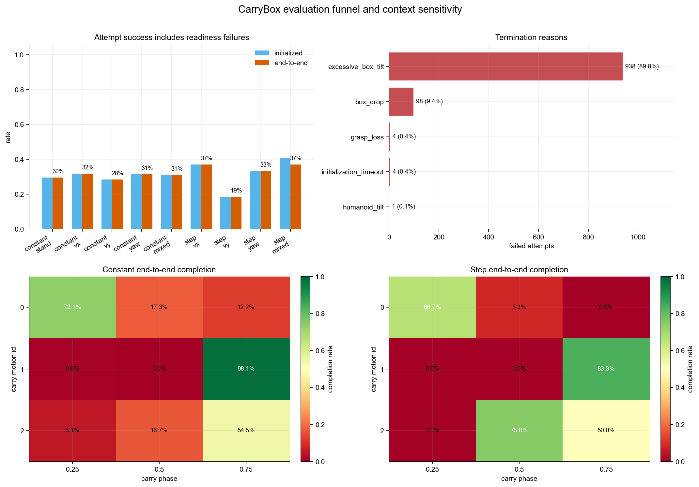
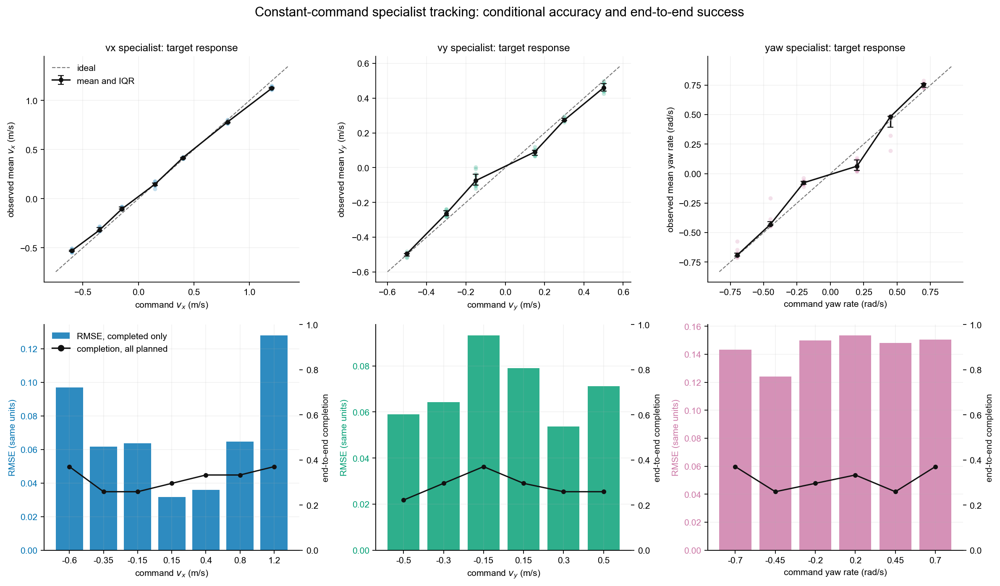
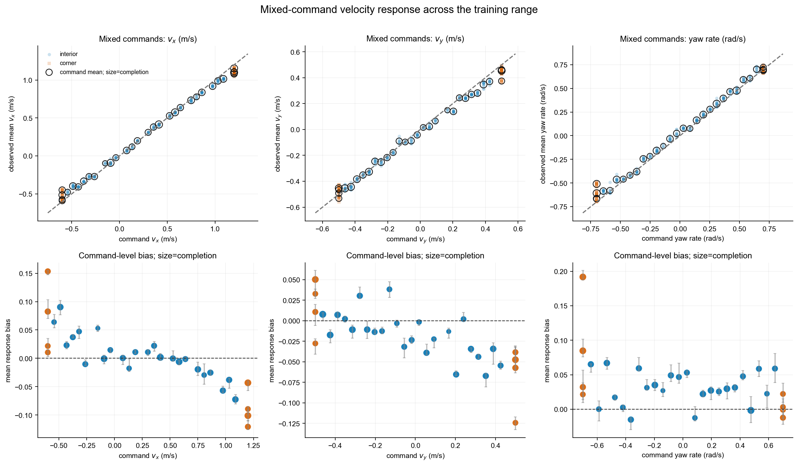
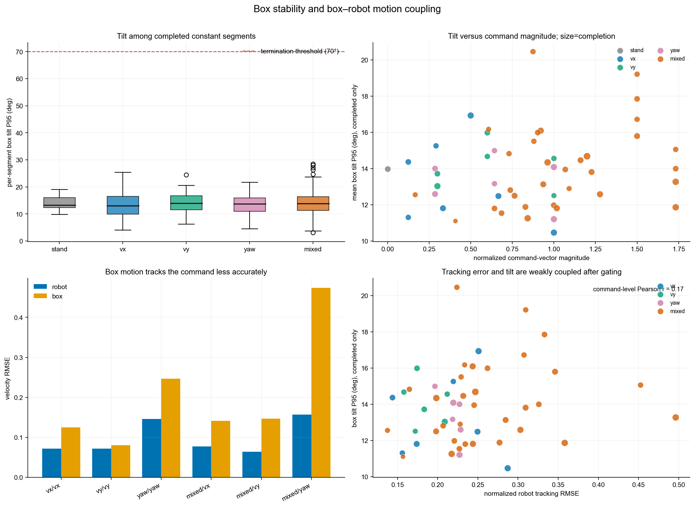
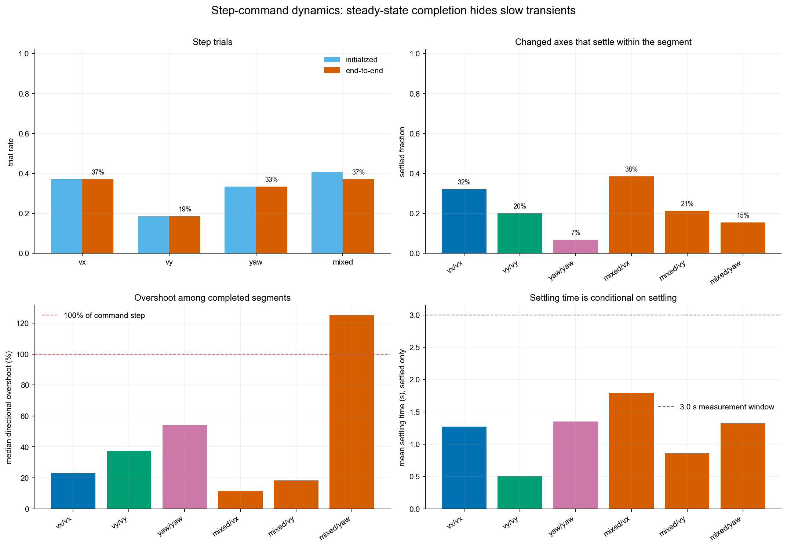
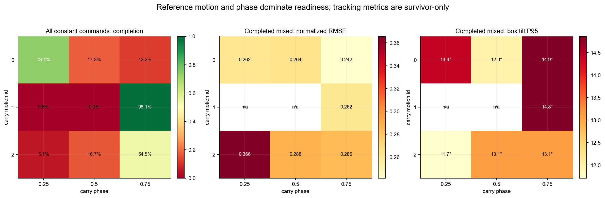

# CarryBox locomotion：velocity tracking 与 box tilt 分析

## 结论摘要

本次数据包含 **1512 个 trial、1944 个计划 segment**，端到端完成 **467/1512 = 30.9%**。主要瓶颈不是进入测量后的 velocity tracking，而是 SETTLE/readiness：938/1045 = **89.8% 的失败由 excessive_box_tilt 触发**。

Constant protocol 初始化成功 433/1404，并且初始化后的 433/433 个 trial 全部完成。Step protocol 初始化成功 35/108，其中 34/35 完成；仅 1 个 mixed step trial 在 MEASURE 阶段因 humanoid_tilt 失败。因此当前系统呈现明显的两阶段行为：初始化经常失败；一旦进入测量，3 s 内保持 carrying 的能力很强。

Completed-only tracking 的稳态增益较好，但这部分结果存在显著 survivor bias。Box tilt 在成功样本中看起来温和，不能据此判断端到端 box stability 已解决。

## 1. 评估口径

- Policy dt 为 0.020 s（约 50.0 Hz）。每个 segment warmup 10 steps，测量 150 steps（3.0 s）。
- readiness 要求连续 11 steps 稳定，最长等待 2.0 s。Box tilt termination threshold 为 70°。
- 速度平面量在 pelvis-yaw frame 中计算，yaw rate 使用 world-z；box planar velocity 同样在 pelvis-yaw frame 中计算。
- Command coverage 是确定性的训练范围覆盖，不是从部署分布独立采样。因此下文的比例是描述性覆盖结果，不应解释为统计置信区间。
- 原始输入：`summary (14).csv` 与 `segment_summary.csv`。当前结果目录没有 `traces/`，所以无法恢复每个 20 ms step 的时序曲线；本报告的 response 图使用每个 3 s segment 的 target、actual mean、RMSE、bias、overshoot 和 settling 指标。

## 2. 不同 command 下的 velocity tracking

### 2.1 单轴 specialist

| Mode | Completed segments | Response gain | Intercept | R² | Mean RMSE |
|---|---:|---:|---:|---:|---:|
| vx | 60 | 0.926 | 0.027 m/s | 0.999 | 0.071 m/s |
| vy | 46 | 0.906 | 0.005 m/s | 0.974 | 0.072 m/s |
| yaw | 51 | 0.962 | 0.013 rad/s | 0.963 | 0.146 rad/s |

VX 对 command 基本线性，但整体增益约 0.93，边界速度略欠跟踪。VY 和 yaw 在小幅 command 附近有明显 dead-zone/保守响应：

- vy=-0.15 m/s 时 observed mean=-0.066 m/s；vy=+0.15 m/s 时 observed mean=0.089 m/s。
- yaw=-0.20 rad/s 时 observed mean=-0.076 rad/s；yaw=+0.20 rad/s 时 observed mean=0.068 rad/s。
- 各 command 的 completion rate 只有约 15%–44%，但它主要反映 readiness/reset 条件，而不是 command 执行后的生存率。因为 command 在 readiness 后才生效，不应把较低 completion 直接归因于该 command 本身。

### 2.2 Mixed command

| Axis | Response gain | Intercept | R² | Mean RMSE |
|---|---:|---:|---:|---:|
| vx | 0.924 | 0.021 m/s | 0.997 | 0.077 m/s |
| vy | 0.928 | -0.021 m/s | 0.993 | 0.064 m/s |
| yaw_rate | 0.962 | 0.038 rad/s | 0.992 | 0.157 rad/s |

Mixed completed segments 的 normalized vector RMSE 平均为 0.269。VX/VY 的命令响应仍接近线性，yaw 是主要误差源。高幅三轴 corner 最困难，尤其是正向高速、横移和转向同时出现时。

最差的 5 个 mixed command（至少 3 个 completed contexts）：

| vx | vy | yaw | Complete | actual vx | actual vy | actual yaw | normalized RMSE |
|---:|---:|---:|---:|---:|---:|---:|---:|
| 1.200 | 0.500 | -0.700 | 40.7% | 1.153 | 0.454 | -0.510 | 0.496 |
| 1.200 | 0.500 | 0.700 | 25.9% | 1.109 | 0.375 | 0.700 | 0.453 |
| 1.200 | -0.500 | -0.700 | 40.7% | 1.098 | -0.454 | -0.608 | 0.358 |
| -0.600 | 0.500 | -0.700 | 33.3% | -0.515 | 0.454 | -0.665 | 0.346 |
| -0.600 | 0.500 | 0.700 | 29.6% | -0.449 | 0.462 | 0.688 | 0.333 |

## 3. Box tilt 与 box velocity

成功的 constant segments 中，box tilt mean 通常约 10.6°，per-segment P95 平均 13.8°，观测到的最大值为 30.2°。这些数值远低于 70° termination threshold。

但全部 1045 个失败 trial 中有 938 个在 SETTLE/readiness 因 excessive_box_tilt 失败。因此结果呈现明显的两阶段并且 tilt 统计被强烈截尾：失败 rollout 在进入 MEASURE 前被剔除，completed-only tilt 图只描述存活子集。

Box velocity 对 command 的误差显著大于 robot base velocity，说明手臂—箱体系统存在相对运动、姿态耦合或角速度放大：

| Mode/axis | Robot RMSE | Box RMSE | Box/robot |
|---|---:|---:|---:|
| vx/vx | 0.071 m/s | 0.125 m/s | 1.74× |
| vy/vy | 0.072 m/s | 0.080 m/s | 1.12× |
| yaw/yaw_rate | 0.146 rad/s | 0.247 rad/s | 1.69× |
| mixed/vx | 0.077 m/s | 0.141 m/s | 1.83× |
| mixed/vy | 0.064 m/s | 0.146 m/s | 2.30× |
| mixed/yaw_rate | 0.157 rad/s | 0.474 rad/s | 3.02× |

Mixed 模式中 box yaw-rate RMSE 达 0.474 rad/s，约为 robot yaw RMSE 的 3.02×。Completed mixed segments 的 robot–box relative linear velocity norm P95 平均为 0.323 m/s。双手接触率平均 99.88%，说明主要问题不是持续失去双手接触，而更像箱体在夹持约束内发生相对运动和姿态摆动。

Completed subset 中 tracking RMSE 与 tilt P95 的 command-level 相关性较弱，进一步说明大倾角失败主要发生在 readiness/reset 阶段，而不是 3 s 稳态 command tracking 的自然延伸。

Completed subset 中 tilt P95 最高的 command：

| Mode | vx | vy | yaw | Complete | tilt P95 | tilt max |
|---|---:|---:|---:|---:|---:|---:|
| mixed | -0.319 | 0.241 | -0.476 | 25.9% | 20.5° | 29.4° |
| mixed | -0.600 | -0.500 | 0.700 | 25.9% | 19.2° | 29.7° |
| mixed | -0.600 | 0.500 | 0.700 | 29.6% | 17.8° | 30.0° |
| vx | -0.600 | 0.000 | 0.000 | 37.0% | 16.9° | 23.4° |
| mixed | -0.600 | -0.500 | -0.700 | 25.9% | 16.7° | 22.9° |

## 4. Step command 动态响应

Step trial 的 initialized-to-completed 比例很高，但严格 settling 指标较弱。Settling tolerance 是 max(0.05, 5% command delta)，且要求之后一直保持在 tolerance 内；因此它比 3 s 平均 tracking 更能暴露振荡与慢响应。

| Sequence/axis | Completed changed segments | Settled | Mean settle time (settled only) | Median overshoot |
|---|---:|---:|---:|---:|
| vx/vx | 50/135 | 32.0% | 1.271 s | 23.0% |
| vy/vy | 25/135 | 20.0% | 0.508 s | 37.5% |
| yaw/yaw_rate | 45/135 | 6.7% | 1.353 s | 54.1% |
| mixed/vx | 52/135 | 38.5% | 1.794 s | 11.5% |
| mixed/vy | 52/135 | 21.2% | 0.856 s | 18.5% |
| mixed/yaw_rate | 52/135 | 15.4% | 1.325 s | 125.2% |

Yaw transient 最差：yaw specialist 只有约 6.7% 的 completed changed segments 满足 settling；mixed sequence 的 yaw median directional overshoot 超过 100%。这与 steady-state yaw gain 接近 1 并不矛盾：均值可以正确，但响应会过冲或持续振荡。

## 5. Carry motion / phase 敏感性

最好的 constant context 是 motion=1, phase=0.75，完成率 98.1%；最差 context 是 motion=1, phase=0.5，完成率 0.0%。motion 1 在 phase 0.50 为 0%，而 phase 0.75 接近 100%，说明 reference pose/phase reset、箱体初始姿态与 readiness controller 的匹配 远比 seed 或 command family 更关键。

## 6. 诊断结论与优先级

### P0：先修复 reset/readiness 的 box orientation 问题

最可能原因按优先级排序：

1. Carry reference 在特定 motion/phase 的 box orientation、hand pose 或 pelvis frame 与环境 reset 不一致。motion 1 phase 0.50 的 0% 通过率是最强证据。
2. Reset 后 box projected gravity / quaternion convention、插值或坐标系存在不连续，导致箱体瞬间接近或越过 70°。
3. Readiness 阶段的上肢夹持控制对 phase-conditioned pose 不够稳定，箱体角速度未被抑制；policy 尚未接收 command 前就失败。
4. Contact solver/box inertia/friction 与 reference 所需夹持力不匹配，使箱体先旋转再掉落；box_drop 是第二大失败原因。

最小验证 logging：每个 reset 从 t=0 开始记录 box quaternion、projected_gravity_box、tilt、box angular velocity、两手接触力、hand-to-box pose、robot–box relative velocity、carry phase 和 termination predicate。按 motion/phase 对齐画前 2 s 曲线。重点比较 motion1/phase0.50 与 motion1/phase0.75。

### P1：改善 box motion，而不只优化 base velocity

Observation 建议显式包含 box projected gravity、box angular velocity、robot–box relative linear/angular velocity、双手 contact state、carry phase、当前 command、上一 command 和 command delta，并检查这些信号在 50 Hz policy timing 下对齐。Reward/objective 应把 base tracking、box orientation、box angular damping、relative motion、contact preservation、action smoothness 分开记录。对 20°/35°/50° tilt 设置连续代价或 curriculum，保留 70° 作为安全 termination，避免只有终止信号导致稀疏 credit assignment。

### P2：修复小 command dead-zone 与 step transient

在训练 command distribution 中增加 ±0.1–0.25 m/s、±0.1–0.3 rad/s 的密集采样，并加入 step/ramp curriculum。若 policy action 是 PD target，应检查 action scale、joint target clipping 和 command change 时的腰部/髋部带宽。可以在部署端做 command low-pass，但评估时应同时保留 raw-step suite，否则滤波会掩盖 controller dynamics。

### P3：建立端到端与条件性能的双指标门槛

建议以后固定同时报告：① initialization/readiness rate；② initialized 后 completion；③ completed-only velocity RMSE；④ all-observed/censored survival；⑤ box tilt failure rate；⑥ box velocity RMSE；⑦ step settling/overshoot。只有 completed-only tracking 会严重高估当前系统能力。

## 7. 输出文件

- `constant_command_summary.csv`：每个 constant command 的计划数、完成率、response、RMSE、tilt 和 box-relative motion。
- `step_transition_summary.csv`：每个 step family/axis 的完成率、settling 与 overshoot。
- `context_summary.csv`：motion × phase 的 readiness、失败原因和 mixed tracking。
- 图表以高分辨率 PNG 提供。